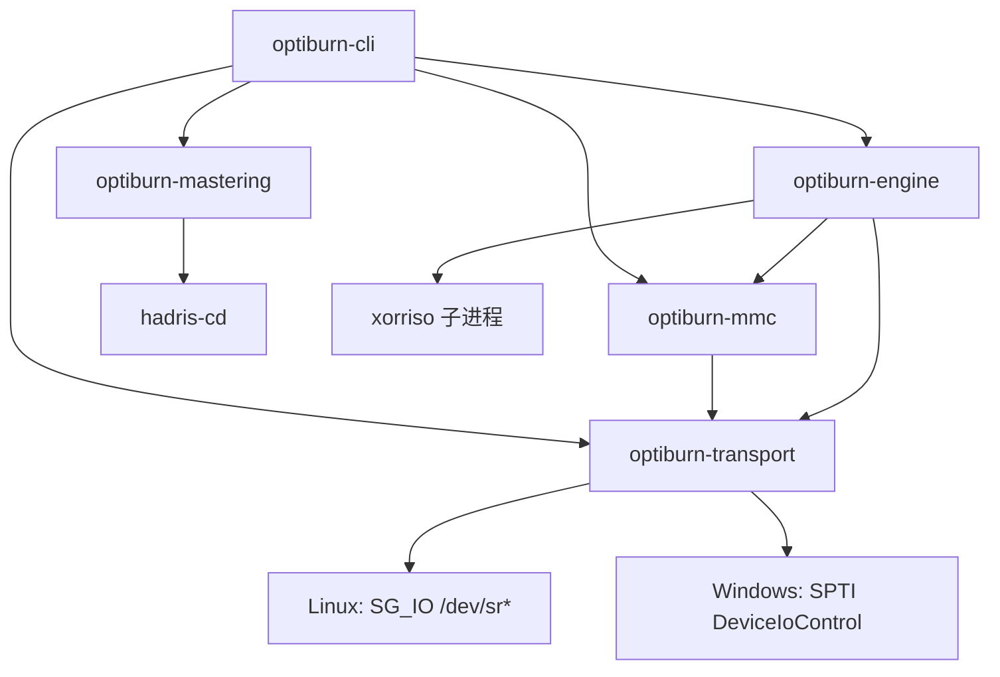

# 架构

optiburn 把目录做成镜像，把镜像或新区段写到盘上，再把盘上的内容读回来。本文件说明各
crate 的边界、数据怎么流动、每个接缝的不变量，以及哪些能力已经验证、哪些还有缺口。
功能清单与安装步骤见 [README](https://github.com/ouyangjiahong26/optiburn#readme)。

## 分层



依赖方向只有一条，自上而下。`cli` 依赖 `engine`、`mastering`、`mmc`，并直接依赖
`transport`（probe 用它打开与枚举设备）。`engine` 依赖 `mmc` 与 `transport`，原生引擎用
前者发命令、用后者打开设备。`mastering` 依赖 `hadris-cd`，`mmc` 依赖 `transport`。没有
反向依赖，也没有 crate 越过接缝去调用另一层的实现。

```
optiburn-cli        命令行：build-image / burn / append / probe / repair / salvage
├── optiburn-mastering   目录做成镜像文件（ISO 9660 + Joliet，按 profile 带 UDF）
│   └── hadris-cd        上游镜像写入器（MIT，纯 Rust）
├── optiburn-engine      镜像写到盘，盘上内容读回来（xorriso 子进程与原生 MMC）
└── optiburn-mmc         MMC 命令编解码（读侧与写侧）
    └── optiburn-transport   SCSI 传输（Linux SG_IO / Windows SPTI）
```

## 数据流

```
源目录 ──build_image──▶ .iso（ISO 9660 + Joliet，按 profile 带 UDF）
                          │
                          ├─ 归档/校验/分发：镜像本身与盘上字节一一对应
                          └─ BurnJob ──BurnEngine──▶ 光驱
                                          xorriso 子进程或原生 MMC

盘 ──ReadBackend──▶ 卷标、末区段格式、目录树、抽取
盘 ──probe──▶ 设备标识 + 盘片状态 + 容量 + 增长后端
```

镜像先落盘再写盘（ADR-0003）是有意为之。镜像文件本身就是可归档、可校验的分发单元，
没有光驱也能把整条链路测完，写盘失败还能重试。代价是镜像内含构建时刻的时间戳（上游把
`now()` 写进 ISO 卷描述符与 UDF 时间戳），同一目录两次构建的字节并不相同。可复现的是
目录顺序与内容，不是镜像字节。

写入有两条路。`burn` 把一份完整镜像写成一个新区段，`append` 读出盘上末区段，把源目录
嫁接上去，新区段只写目录结构与新增数据。读侧把末区段的卷标、目录树与文件数据交给上层，
回读校验与追加门禁都建在它上面。

## 接缝与不变量

### optiburn-transport

接口：`ScsiTransport::issue(cdb, dir, data, timeout)` 一条同步命令，加上
`Direction`、`Completion`、`TransportError`，按平台分发的 `open(device)`，
`list_optical_devices()`（枚举本机光驱设备路径，非 Linux 返回空列表），以及
`mounted_at(device)`（设备被系统挂载时返回挂载点，写前门禁据此拦截，见 ADR-0010）。

隐藏：`SG_IO` 的 `sg_io_hdr` 组装，SPTI 的 `SCSI_PASS_THROUGH_DIRECT` 组装，两套方向
枚举语义相反这件事（Linux `SG_DXFER_TO_DEV = -2`，Windows `SCSI_IOCTL_DATA_OUT = 0`），
句柄生命周期，超时单位（Linux 毫秒，Windows 秒）。

不变量：CDB 最多 16 字节，超长返回 `CdbTooLong` 而不是 panic。sense 最多 32 字节。
宿主机层错误（`host_status` 与驱动状态）也算失败，不允许悄悄成功。

### optiburn-mmc

接口：`MmcDevice` 上的读侧命令 `inquiry`、`test_unit_ready`、`read_disc_information`、
`read_track_information`、`read_toc_session_info`、`read_toc_tracks`、`read_capacity`、
`read_blocks`、`read_format_capacities`、`read_disc_capacity`，写侧命令
`get_configuration`、`set_write_parameters`、`reserve_track`、`write_blocks`、
`synchronize_cache`、`close_session`。返回 `Inquiry`、`DiscInformation`、`TrackInfo`、
`SessionInfo`、`MediaKind`、`FormatCapacity`、`DiscCapacity` 等结构。`DiscCapacity` 是给
上层的容量视图（总容量与可用容量），两个口径的来源与退回规则见 ADR-0019。

隐藏：CDB 字节序与分配长度字段位置（`READ DISC INFORMATION` 的分配长度在 CDB 第 7 与
第 8 字节），响应里哪些位是盘片状态（字节 2 的低 2 位，同一字节还带 last-session 状态与
erasable 标志），尾部空格与 NUL 填充，短响应判定（用 `residual` 反推实际长度），
READ FORMAT CAPACITIES 的变长列表解析（按实际长度而不是满长判定，描述符类型位在字节 4
的低 2 位，实机验证见 ADR-0019），写参数页（Mode Page 5）的字段，Close Function 的
位置，Profile 到写序列分组的映射。写侧 CDB 与字段逐条对照 libburn，见 ADR-0017 与
ADR-0030。

这一层不做增长会话的合并，也不做 ISO 9660 与 UDF 的解析。CD 介质的 ATIP 读取仍未
实现（format 字段布局有两种写法被实机证伪），容量不依赖它（见 ADR-0019）。

### optiburn-mastering

接口：`build_image(source_dir, output, spec) -> ImageInfo`。`ImageSpec` 只有三件事：
介质 profile、卷标、是否 Joliet。

隐藏：profile 到文件系统的映射表（本文件之上和 `docs/WINDOWS-COMPAT.md` 里那张表），
hadris-cd 的选项组装，输出文件必须以读写方式打开（hadris 写完卷描述符后会回读并就地
打补丁，只写句柄会 `EBADF`），镜像按 2048 字节扇区对齐。

不变量：同一输入的目录顺序确定（hadris 的 `FileTree::from_fs` 递归读取时按名字排序，
跳过符号链接），但镜像内含构建时刻时间戳，字节不跨次一致。`ImageInfo.filesystems` 从
真正交给写盘器的选项反推，`ImageInfo.sectors` 只在字节数是 2048 的整数倍时给出（否则报
`MisalignedImage`，不假装知道扇区数）。

### optiburn-engine

写侧有两个入口。`BurnEngine::{name, burn}` 把一份镜像写到盘上，现有 `XorrisoEngine`
（子进程）与 `NativeEngine`（自己发 MMC 命令，见 ADR-0017）。`BurnJob` 带镜像、设备、
倍速、是否多区段。追加走 `GrowJob`，带源目录、设备、倍速、卷标、是否封盘。进度都通过
`&mut dyn FnMut(f32)` 回调。

#### 写入

原生引擎从 NWA 起写，按 Profile 选择写参数页与收尾顺序，写完可用原生读侧读回对拍。
CD-R 已在 Windows 真机验证，DVD-R 已在 Linux 真机验证。DVD-R 的补位与先关轨道再关
区段的顺序记在 ADR-0030。原生引擎拒绝时给出结构化的 `NativeGap`，调用方能区分“介质
不支持”与“这个功能还没做”。

#### 增长

`grow` 默认走原生增长（`native::grow` 读旧区段、生成新区段，生成器在 `grow.rs` 与
`grow/old_session.rs`，见 ADR-0020），Windows 与 Linux 都一样。Linux 上每次写入前按
驱动器的静态事实与调用方的请求解析实际后端：随机可写介质、Profile 不在支持名单、
指定倍速三条命中时回退 xorriso 增长模式（ADR-0027）。图形前端与
`OPTIBURN_GROW_BACKEND` 可以显式选择后端，显式选择不回退。

#### 读盘

读侧五个能力 `read_volume_id`、`iso_session_state`、`list_tree`、`extract_tree`、
`extract_paths` 接在 `ReadBackend` 接缝上。`XorrisoRead` 是子进程，`NativeRead`
是原生块读加 ISO 9660 与 UDF 解析（ADR-0018、ADR-0021、ADR-0024）。Windows 默认原生，
Linux 先走 xorriso，读不到 ISO 9660 时回退原生。

#### 门禁与校验

`grow_size` 是增长模式的尺寸预演，返回即将写入的新区段字节数，供写前容量门禁比较。
默认取原生增长会话计划的尺寸，回退到 xorriso 时是 `xorriso -print_size`（ADR-0027）。
`append_gate_session_state` 是写前门禁的末区段判定，读法跟随写盘引擎（ADR-0028）。
`capacity_gate` 把待写入量与区段开销相加，再与可用容量比较，区段开销按动作与介质取值，
优先用盘上实测几何（ADR-0019 修订）。`compare_trees` 按文件名与内容单向对比，回读校验
用它（ADR-0010）。

#### 隐藏与已知缺口

隐藏：`xorriso -as cdrecord` 与增长模式（`-dev … -map <目录> / -commit`，见 ADR-0006）
的参数拼装（路径按 `OsStr` 原样传递，不做有损转换），名字侧字符集固定
`-local_charset UTF-8`（与消息侧的 `LC_ALL=C` 解耦，见 ADR-0026），stderr 上的百分比
解析，失败时从 stderr 尾部取摘要，区分工具缺失（`MissingTool`，载荷只有工具名，安装
指引由 CLI 与 GUI 按系统给出，见 ADR-0004 补记）与其它 I/O 错误（`Io`），原生写序列
与块与块之间的取消检查，原生读侧的区段候选枚举（READ TOC Format 0 与 1）、两种区段
地址约定的探测、损坏末区段的回退与 UDF 的三种定位约定（ADR-0018、ADR-0021、ADR-0022），
原生增长会话的布局（绝对地址、两套目录树、四张路径表，ADR-0020）。

已知缺口：xorriso 引擎的进度只是粗粒度提示，cdrecord 风格输出里缓冲区与 fifo 的百分比
与写入百分比同格式，成功时统一补发 1.0。原生引擎的进度按已写块数算，是精确的。原生
引擎还缺倍速协商、写失败重试、DVD+R 族与 BD-R 的封盘路径（ADR-0017、ADR-0027）。
原生增长不结转 Rock Ridge 元数据，也没有 Joliet 之外的名字扩展（ADR-0020）。UDF 读侧
的能力边界见 ADR-0021。

### optiburn-cli

接口：六个子命令。`burn` 与 `append` 先跑前置检查（`ensure_burnable`：挂载占用与末区段
格式直接拒绝，等介质就绪，按盘片状态路由放行或拒绝，见 ADR-0006 与 ADR-0010），再过
写前容量门禁（`ensure_fits` 转调引擎的 `capacity_gate`，超过可用容量时把待写入、区段
开销、可用容量三个数字摊开，读不到容量口径则跳过，见 ADR-0019 修订），然后进引擎。
`repair` 与 `salvage` 是两条救人路径，前者写盘，后者只读，顺序见 ADR-0022。`probe` 在
任何情况下都以 0 退出（没光驱不是错误），行尾带盘片容量与增长后端。真正失败（路径不
存在、刻录退出码非零）退 1 并把原因写到 stderr。

### 图形前端

图形前端在 `src-tauri/`（Tauri 2）与 `frontend/`（React、Vite、TypeScript），不在根
workspace 内，以路径依赖引用核心 crate。四个页面覆盖五个子命令，`repair` 只在命令行。
核心五个 crate 不引入 GUI 依赖。剪贴板这类平台能力差异收在 `src-tauri` 的独立平台模块
里（ADR-0012）。

## 平台分派

| 能力 | Linux | Windows |
|---|---|---|
| `build-image` | 原生 | 原生 |
| `burn` | 默认 xorriso，可选原生（DVD-R 已真机验证） | 原生，CD-R 已真机验证 |
| `append` | 默认原生增长，按设备事实与请求回退 xorriso | 原生增长 |
| `probe` | `/dev/sr*` | `E:` |
| 读盘 | xorriso 优先，读不到 ISO 9660 时回退原生 | 原生 ISO 9660 与 UDF |
| `repair` | xorriso `-close_damaged` | 原生 |
| `salvage` | 原生 MMC 读侧 | 原生 MMC 读侧 |

平台分支默认收在 `optiburn-transport`。GUI 侧的平台差异主要收在 `src-tauri` 的独立模块
里，命令层的引擎分派仍有一处 `cfg!(windows)`（ADR-0017）。

## 现状与边界

| 能力 | 已验证 | 未验证或风险 |
|---|---|---|
| 镜像布局 | 扇区级断言，xorriso 回读对拍，含中文名 | 上游版本升级后布局是否漂移，由测试拦截 |
| 原生刻录 | CD-R（2026-10-10，Windows），DVD-R（2026-10-22，Linux，两台驱动器） | DVD+R、DVD+RW、BD-R。Windows 上的 DVD-R 与 Linux 上的 CD-R 未单独验证 |
| 原生增长 | Linux 多区段 CD-R（2026-10-15），写前 51.0 秒降到 1.6 秒 | DVD+R 与 DVD+RW 追加，BD-R 追加 |
| 原生读盘 | Windows CD-R（2026-10-10），两种区段地址约定，Linux 设备路径回退（2026-10-12） | 纯 UDF 实物盘 |
| 抢救 | 被中断写入的盘（2026-10-11） | 其它中断形态未逐一真机验证，按候选区段回退处理，见 ADR-0022 |
| 四个目标构建 | `cargo check` 覆盖四个目标 | 现有硬件验证记录都在 x86_64 机器上，arm64 只做构建检查 |

## 后续工作

- 原生引擎的倍速协商（SET CD SPEED）与写失败重试。
- DAO/SAO 写入路径，目前只有 TAO 与增量写。
- BD-R 与 DVD±RW 的介质验证，DVD+R 与 DVD+RW 的增长实测。
- CD 介质的 ATIP 读取，容量目前不依赖它。
- 原生增长的 Rock Ridge 结转与名字扩展，现在只有 Joliet。
- Windows 上的 IMAPI2 校验（只校验，不接管写入，见 ADR-0005）。
- 纯 UDF 实物盘在 Linux 上的读取验证，目前只有合成夹具与设备路径上的 ISO 盘证据。
